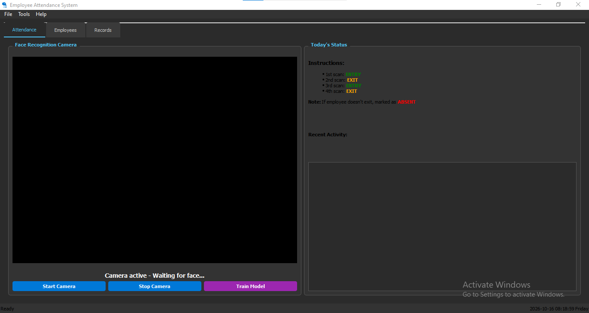
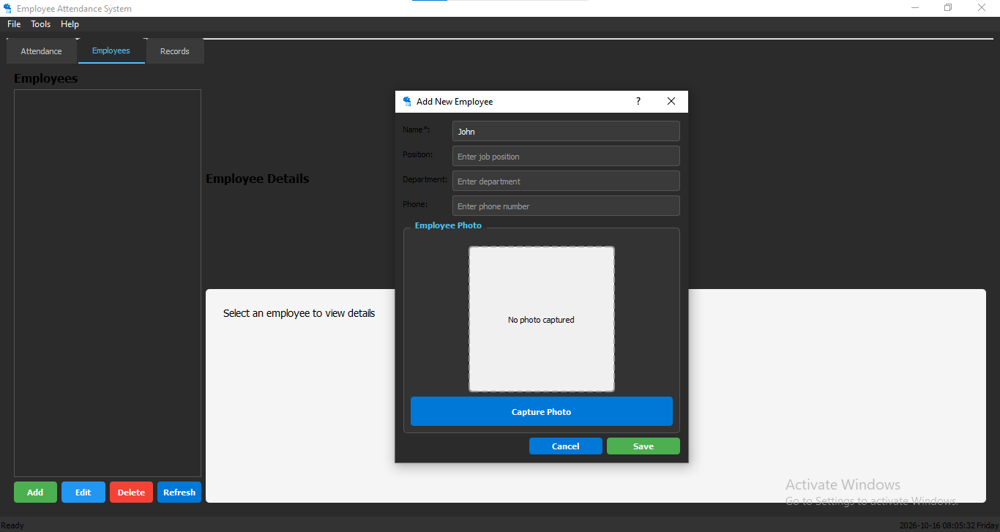
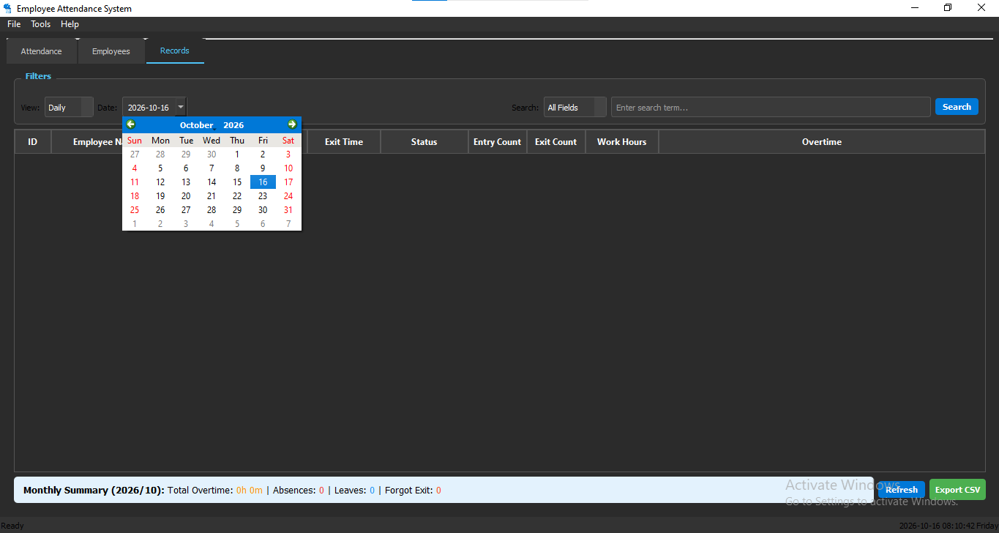
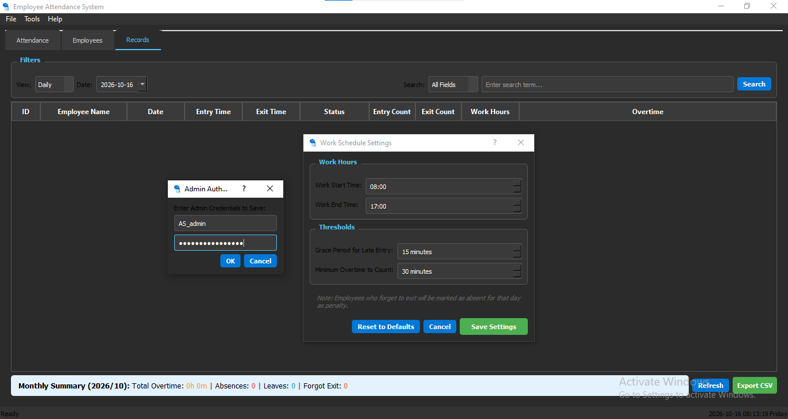

<div dir="rtl" align="right">

# نظام حضور وانصراف الموظفين

**تطبيق مكتبي لنظام Windows باستخدام C++ وQt وOpenCV وSQLite**

[English](README.md) · [فارسی](README.fa.md) · [العربية](README.ar.md) · [简体中文](README.zh-CN.md)

</div>

## نبذة عن المشروع

نظام حضور وانصراف الموظفين هو تطبيق مكتبي لنظام Windows لإدارة بيانات الموظفين، ومراجعة أحداث الحضور والانصراف، وضبط قواعد ساعات العمل، وتصدير بيانات الحضور. يتضمن التطبيق سير عمل باستخدام الكاميرا يعتمد على كشف الوجوه ومقارنة الصور عبر OpenCV. المشروع مخصص لعرض المهارات البرمجية، وليس منتجاً معتمداً للموارد البشرية أو تسجيل الوقت أو الأمن أو تحديد الهوية البيومترية.

## الميزات

- **لوحة Attendance:** عرض حالة الحضور وسير عمل تسجيل الحضور باستخدام الكاميرا.
- **إدارة الموظفين:** إنشاء سجلات الموظفين وعرضها وتعديلها وحذفها، بما في ذلك صور الملفات الشخصية.
- **سجلات الحضور:** مراجعة السجلات والبحث فيها وتصدير بيانات الجدول إلى CSV.
- **إعدادات العمل:** ضبط قواعد ساعات العمل والحد الأدنى لاحتساب العمل الإضافي.
- **قاعدة بيانات محلية:** تخزين SQLite عبر Qt SQL.
- **معالجة الوجوه:** كشف الوجوه باستخدام Haar Cascade ومقارنة/تدريب قائم على الصور. لم تُقيّم دقة التعرّف بشكل مستقل.
- **تعريف مثبّت Windows:** يتضمن المشروع نص Inno Setup؛ وتُحفظ ملفات التشغيل التابعة للمثبّت بصورة منفصلة عن ملفات المصدر.

## لقطات الواجهة

| Attendance | Employees |
|---|---|
|  |  |

| Records | Settings |
|---|---|
|  |  |

## التقنيات

- **اللغة:** C++
- **واجهة سطح المكتب:** Qt Widgets؛ يستهدف إعداد المشروع Qt 5.15.2 وMSVC 2019 وبيئة 64 بت.
- **الرؤية الحاسوبية:** OpenCV 4.5.5
- **قاعدة البيانات:** SQLite عبر Qt SQL
- **بيئة البناء:** Visual Studio 2019 ومجموعة الأدوات `v142` وتكامل Qt/MSBuild
- **النظام المستهدف:** Windows x64

تحتوي ملفات مشروع Visual Studio على مسارات اعتماد مرتبطة ببيئة التطوير المحلية وقد تحتاج إلى تعديل على جهاز آخر. لم يتم التحقق من البناء على نظام نظيف ضمن إعداد هذا المستودع.

## بيانات الدخول التجريبية

بيانات الدخول التالية مضمنة بشكل ثابت في مصدر التطبيق ومذكورة لتسهيل التنقل في النسخة التجريبية فقط. لا توفر هذه الطريقة مصادقة آمنة. وبما أن المستودع عام، يمكن لأي زائر قراءة هذه القيم. لا تستخدمها لحماية بيانات الموظفين أو البيانات البيومترية الحقيقية.

| القسم | اسم المستخدم | كلمة المرور |
|---|---|---|
| Employees | `AS_admin` | `AS_P@ssword-Emp` |
| Records | `AS_admin` | `AS_P@ssword-Rec` |
| Settings | `AS_admin` | `AS_P@ssword-Sett` |

## البناء من المصدر

1. ثبّت Visual Studio 2019 مع حمل تطوير تطبيقات سطح المكتب باستخدام C++ وWindows SDK.
2. ثبّت إعداد Qt المتوقع للمشروع: `5.15.2_msvc2019_64`، مع تكامل Visual Studio.
3. ثبّت OpenCV 4.5.5 بنسخة x64 وعدّل مسارات include وlibrary في `src/AttendanceSystem/AttendanceSystem.vcxproj` لتناسب البيئة المحلية.
4. افتح `src/AttendanceSystem/AttendanceSystem.vcxproj` في Visual Studio، واختر **Release | x64** ثم نفّذ البناء.
5. وفّر إضافات Qt المطلوبة للمنصة وSQL وصيغ الصور، وملف OpenCV DLL، ونموذج Haar Cascade للتطبيق.
6. اختبر الناتج على نظام Windows x64 نظيف قبل التوزيع.

تم الحفاظ على بنية مصدر Visual Studio الأصلية. واستُبعدت مخرجات البناء وإعدادات المستخدم الخاصة بالجهاز وبيانات الموظفين التشغيلية.

## المثبّت

يوجد تعريف Inno Setup في [`installer/InstallerScript.iss`](installer/InstallerScript.iss). المسار الافتراضي للتثبيت هو مجلد داخل سطح مكتب المستخدم الحالي، واختصار سطح المكتب اختياري وغير محدد افتراضياً. ملفات التشغيل التابعة للمثبّت غير مضمنة في مستودع المصدر، ولم يتم تجميع النص أو اختباره ضمن هذا الإصدار. قد تؤثر سياسات Windows وOneDrive في صلاحيات الكتابة.

ينشئ النص المجلدين `data/` و`data/faces/` داخل مجلد التثبيت لمطابقة مسار قاعدة البيانات النسبي في التطبيق `data/attendance.db`. يجب اختبار الحزمة النهائية للتحقق من كتابة قاعدة البيانات والصور، وتحميل إضافات Qt، والوصول إلى الكاميرا، وإزالة التثبيت، وسلوك الاختصار.

## الخصوصية والقيود والترخيص

- هذا مشروع لعرض المهارات، وليس منتجاً معتمداً للموارد البشرية أو تسجيل الوقت أو الأمن أو تحديد الهوية البيومترية.
- قد تنتج مطابقة الوجوه نتائج خاطئة أو تفشل في اكتشاف الوجه. تتطلب القرارات المهمة مراجعة بشرية ووسيلة بديلة مناسبة لا تعتمد على القياسات الحيوية.
- استخدم بيانات اصطناعية أو بيانات لديك تصريح واضح لاستخدامها، والتزم بالقوانين المعمول بها بشأن الخصوصية والعمل والبيانات البيومترية.
- لا يثبت هذا المستودع أن قاعدة البيانات المحلية مشفرة أو محمية بضوابط وصول مناسبة للإنتاج.
- لكل من Qt وOpenCV وSQLite وإضافات Qt والاعتماديات الأخرى شروط ترخيص وإشعارات منفصلة؛ راجع [`THIRD_PARTY_NOTICES.md`](THIRD_PARTY_NOTICES.md).
- ملف [`LICENSE`](LICENSE) إشعار حقوق خاص بالمشروع وليس ترخيصاً مفتوح المصدر معتمداً من OSI. إتاحة المستودع للعامة لا تمنح تلقائياً حق إعادة استخدام الشيفرة الأصلية أو إعادة توزيعها.
- يجب مراعاة شروط ترخيص إصدار Inno Setup المستخدم قبل توزيع مثبّت مبني به.

## بنية المستودع

```text
.
├── README.md
├── README.fa.md
├── README.ar.md
├── README.zh-CN.md
├── LICENSE
├── .gitignore
├── .gitattributes
├── .editorconfig
├── THIRD_PARTY_NOTICES.md
├── SECURITY.md
├── CONTRIBUTING.md
├── PROJECT_STRUCTURE.md
├── assets/screenshots/
├── src/AttendanceSystem/
└── installer/
```

## حالة المشروع

**مشروع لعرض الأعمال.** يتضمن المستودع ملفات المصدر وإعدادات Visual Studio. ملفات صور الواجهة وملفات التشغيل التابعة لحزمة التثبيت منفصلة عن حزمة المصدر. لم يتم تجميع المثبّت أو التحقق منه على نظام نظيف.

## المؤلف

**Arsham Sarmast**

